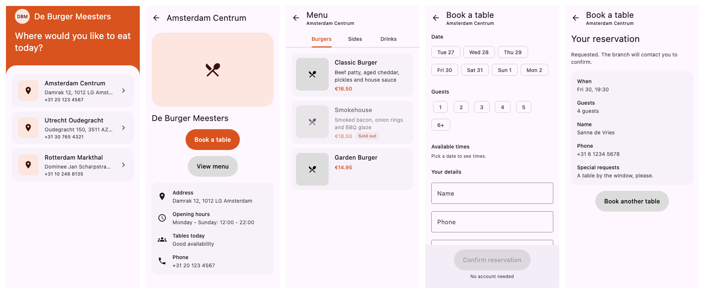
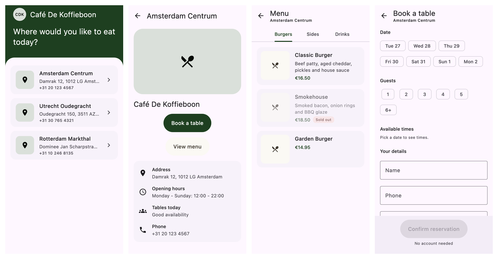

# WhiteLabelRestaurant

A white-label restaurant app engine built with **Kotlin Multiplatform** and **Compose Multiplatform**. One shared codebase serves many restaurant brands ("tenants"): a guest picks a branch, browses its menu and requests a table, all in the brand's own name and colours.

There is no fork per brand. The app works out which brand it is from its own application ID at runtime and loads that brand's name, colours, branches and menus from Firestore.

| Platform | Brand | Application ID |
|---|---|---|
| Android | Burger Joint | `com.burgerjoint.app` |
| iOS | Cafe Local | `com.cafelocal.espresso` |
| Desktop (JVM) | chosen with a JVM flag | — |

## Screenshots

Rendered from the Compose previews with sample data, in each brand's palette.

**Burger Joint**



**Cafe Local**



## Features

- **Brand theming at runtime:** the brand's name and primary/secondary colours come from Firestore and tint the Material 3 theme. The launcher icon and launch screen are built into each app, because they appear before Firestore loads.
- **Choose a branch:** a live list of the brand's branches, with address and phone number.
- **Branch details:** address, opening hours, today's table availability and phone, with buttons to view the menu or book a table.
- **Menu:** one swipeable tab per category, with prices in euros and sold-out dishes dimmed and tagged.
- **Book a table:** pick a date in the next 7 days, the party size (1–6+) and a time slot (slots in the past are disabled), then enter contact details. Name, phone and email are validated before sending, and no account is needed.
- **Your reservation:** if the guest already has an upcoming booking at the branch, the booking screen shows it instead of the form: date and time, guests, contact details and its status, which updates live when staff change it. "Book another table" brings the form back. The app remembers bookings on the device that made them, since guests have no account.
- **Live data:** branches and menus are Firestore snapshot listeners, so edits in the console show up in the app straight away.
- **Errors:** offline, permission-denied and not-found failures are each shown with their own message, and branch loading can be retried.

## Running it

The Firebase config file for each brand is committed, so both apps connect to the shared Firebase project (`skyhigh-restaurant-engine`) straight from a clone.

**Android** (Android Studio, or):

```sh
./gradlew :androidApp:installBurgerjointDebug
```

**iOS:** open `iosApp/iosApp.xcodeproj` in Xcode, pick the **Cafelocal** scheme and run. Xcode resolves the Firebase iOS SDK (Swift Package Manager) on first open, and the build runs `./gradlew :shared:embedAndSignAppleFrameworkForXcode` itself. On a fresh machine you may first need to:

```sh
sudo xcodebuild -license accept   # accept the Xcode licence
xcodebuild -runFirstLaunch        # install/update the simulator components
```

**Desktop:**

```sh
./gradlew :desktopApp:run -Dtenant.applicationId=com.burgerjoint.app
```

The desktop target compiles, but Firebase isn't initialised there yet, so it can't load brand data.

**Tests:**

```sh
./gradlew :shared:jvmTest                # fastest
./gradlew :shared:testAndroidHostTest
./gradlew :shared:iosSimulatorArm64Test
```

## Architecture

```
shared/        all engine code and UI (also built as the static iOS framework "Shared")
androidApp/    Android entry point; one product flavor per brand
iosApp/        SwiftUI shell; one xcconfig, build configuration and scheme per brand
desktopApp/    JVM entry point
branding/      source logo (SVG) for each brand
```

Inside `shared/src/commonMain/kotlin/com/skyhightechnology/restaurantengine/`:

| Layer | Contents | Rules |
|---|---|---|
| `domain/` | models and the `RestaurantRepository` interface | pure Kotlin: no Compose, Firebase, serialization or Koin |
| `data/` | `@Serializable` Firestore DTOs and `FirestoreRestaurantRepository` (GitLive Firebase SDK) | the only place Firebase is used |
| `presentation/` | Compose screens and ViewModels, each exposing a `StateFlow` of UI state | never imports `data` |
| `di/` | Koin modules | the only place implementations are bound to interfaces |

**How the brand is chosen.** `getApplicationId()` is an `expect` function: Android returns the package name, iOS the bundle identifier, and desktop the `tenant.applicationId` system property. Koin provides this value as the tenant ID, which is also the brand's Firestore document ID (`restaurants/{applicationId}`).

**Errors and text.** Repositories throw only `DataException(DataError)`. ViewModels turn that into a sealed `LoadError` / `ReservationError` in their state, and composables map each case to a string resource. All user-facing text lives in `composeResources/values/strings.xml`.

**Navigation.** [Navigation 3](https://developer.android.com/guide/navigation/navigation-3) (`NavDisplay`, in `presentation/App.kt`). The back stack is a plain list of `@Serializable` routes, starting with the branch list: choosing a branch adds its details screen, which leads to the Menu and Book-a-table screens. Back, with the app bar arrow or the system back gesture, removes the last screen, and back on the branch list leaves the app. Each screen's ViewModel belongs to its back stack entry, so it is cleared when the screen is closed.

**Previews.** Each screen is split into a ViewModel wrapper and a stateless `…Content` composable. The `*Previews.kt` files next to each screen render the content for both brands and for loading, empty and error states, using sample data from `presentation/preview/PreviewData.kt`.

## Firestore data

```
restaurants/{applicationId}                  name, primaryColor, secondaryColor (hex, e.g. "#D9531E")
  branches/{branchId}                        branchName, address, phoneNumber,
                                             openingHours (free text), isAvailable (tables today)
    menu/{itemId}                            name, description, price (integer cents: 1650 = €16.50),
                                             category, imageUrl, isAvailable
    reservations/{auto id}                   written by the app: customerName, customerPhone,
                                             customerEmail, specialRequests, partySize,
                                             reservationTime (ISO-8601 UTC), status ("PENDING";
                                             staff set "CONFIRMED", "CANCELLED" or "DECLINED")
```

## Adding a brand

1. Create `restaurants/{applicationId}` in Firestore, with branches and menus.
2. Register the app ID in Firebase and download its config file.
3. **Android:** add a product flavor in `androidApp/build.gradle.kts` (`applicationId` and `app_name`), plus `src/<flavor>/res` with the brand colours, splash logo and launcher icons.
4. **iOS:** add `iosApp/Configuration/<Brand>.xcconfig` (bundle ID, `BRAND`, icon and launch-screen asset names), its Debug/Release configurations and a scheme, `iosApp/<brand>/GoogleService-Info.plist`, and the brand's assets in `Assets.xcassets`.

No shared code changes are needed.

## Testing

Unit tests live in `shared/src/commonTest` and run on JVM, Android and iOS. They use `kotlin.test`, `runTest` and [Turbine](https://github.com/cashapp/turbine) for flows, with a hand-written `FakeRestaurantRepository` instead of a mocking library (mocking libraries don't run on Kotlin/Native). They cover the ViewModels, booking slots and validation, the Firestore DTO mapping and error mapping, the theme colours and the Koin graph.

UI tests in `shared/src/jvmTest` (`*ContentTest`) render each screen off-screen on the JVM with Compose's `runComposeUiTest`, so they need no emulator. They tap and type like a guest would and check what each screen shows and sends: picking a branch, the branch details buttons, menu tabs and sold-out dishes, the booking form (past slots, Confirm enabled only when complete, the booking sent) and the existing-reservation view. Things that need a real device, such as Firebase, the system back gesture and the keyboard, still need checking on an emulator.

## Known limitations and next steps

- **Reservations are only stored, not processed.** Confirming a booking just saves a `PENDING` document under the branch in Firestore. There is no backend behind it: nothing checks capacity or double bookings, and the guest gets no email or SMS. Staff confirm or cancel a booking by editing its `status` by hand (for example in FireCMS), and the guest sees the change in the app. Time slots are a fixed list in the app rather than coming from each branch, and "Tables today" is a flag the restaurant sets by hand.
- **Bookings are remembered per device:** the app finds a guest's booking only on the device that made it, and only the latest booking per branch. Reinstalling the app or switching phones loses it.
- **Placeholder images:** branch and dish images are placeholder icons; `imageUrl` isn't loaded yet.
- **Light theme only:** the brand colour scheme is light-only, and some surfaces still use the default Material palette.
- **Opening hours are free text,** so the app can't show "Open now".
- **Desktop doesn't load data,** because Firebase isn't initialised on the JVM target.
- **No sign-in:** guests are anonymous. The Firestore security rules allow public reads and reservation writes, and the API keys should be restricted to their apps before any public release.
